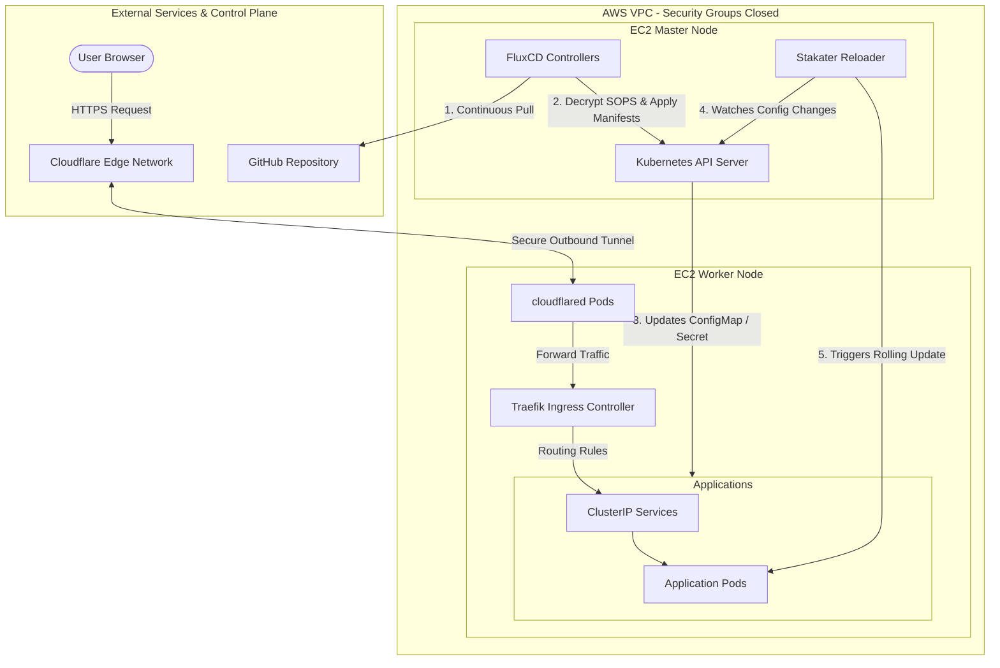
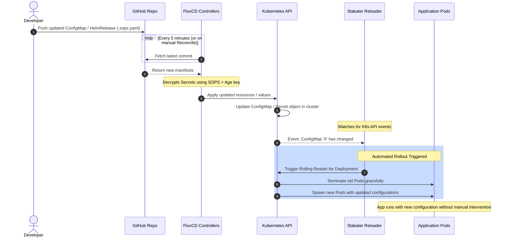

# GitOps Kubernetes Cluster (k3s) with AWS, Flux, SOPS, and Cloudflare Zero Trust

## 1. Purpose of the Repository
This repository manages a declarative, GitOps-driven Kubernetes architecture. The underlying infrastructure consists of a lightweight **k3s** cluster hosted on AWS (currently structured with one Master node and one Worker node). 

The core philosophy of this project is **GitOps**: the Git repository is the single source of truth for the entire cluster state. Every deployment, configuration, and infrastructure component inside the cluster is automated and managed through **FluxCD**. This setup is designed to be cloud-agnostic, making it easily replicable on other cloud providers like Azure or GCP in the future.

---

## 2. Infrastructure Provisioning (Terraform & k3s)
The underlying AWS infrastructure (EC2 instances, networking, and security) was provisioned and managed using **Terraform**. 

### Architecture Evolution (Zero Trust)
Initially, the AWS Security Groups followed a traditional approach, exposing ports 80 and 443 to the public internet. 
Following the implementation of Cloudflare Tunnels (detailed in Section 7), the architecture was hardened into a strict **Zero Trust model**. All public inbound rules were completely removed from the Security Groups, rendering the EC2 instances invisible to the internet.

### Node Bootstrap Process
The k3s cluster currently consists of a Master node and a Worker node:
1. **Master Node**: Bootstrapped via a Terraform initialization script that installs k3s and starts the control plane.
2. **Worker Node**: Configured to automatically join the k3s cluster upon creation. The required connection parameters (`K3S_URL` and `K3S_TOKEN`) are securely managed and passed into the setup via a `variables.tfvars` file.

*(Note: A dedicated README covering the complete Terraform infrastructure, variables, and module structures will be provided separately).*

---

## 3. FluxCD Setup (GitOps Bootstrap)
Flux was chosen as the GitOps operator to continuously reconcile the cluster state with this repository. 

To link the physical k3s cluster to this GitHub repository, the following bootstrap command was executed on the master node (with a valid GitHub Personal Access Token configured):

```bash
flux bootstrap github \
  --owner=AndreaProzzo21 \
  --repository=flux-k3s \
  --branch=main \
  --path=clusters/k3s-flux-lab \
  --personal
```

**What this achieved:**

* Installed the Flux controllers inside the cluster.
* Generated deploy keys and automatically added them to the GitHub repository.
* Configured Flux to continuously monitor the `clusters/k3s-flux-lab` path and apply any manifests found there.

---

## 4. Cluster Foundations

With Flux running, the foundational layers of the cluster were established using standard Kubernetes manifests and Kustomizations. We structured the repository to handle core namespaces cleanly:

* `infrastructure/`: For cluster-wide tools (Ingress controllers, monitoring, Cloudflare).
* `apps/`: For custom workloads and user-facing applications.

---

## 5. Secrets Management with Mozilla SOPS & Age

Storing sensitive data (passwords, tokens, API keys) in a Git repository requires robust encryption. We implemented **Mozilla SOPS** combined with **Age** encryption to seamlessly integrate secrets into the GitOps workflow.

### Setup Process:

1. **Key Generation**: Generated an Age key pair locally (`age-keygen -o age.agekey`).
2. **Cluster Provisioning**: The private key was injected into the cluster as a Kubernetes Secret (`sops-age` in the `flux-system` namespace) so Flux can decrypt files on the fly.
3. **Repository Configuration**: A `.sops.yaml` configuration file was added to the repository root, mapping the public Age key to all `*.sops.yaml` files.

### Security Failsafe (Git Pre-Commit Hook)

To prevent accidentally pushing unencrypted secrets to GitHub, a Git hook (`pre-commit` / `pre-push`) was implemented. The script scans any staged file ending in `.sops.yaml`. If the file does not contain the `sops:` metadata key (which SOPS appends upon successful encryption), the commit/push is blocked.

**Workflow:** Write the `Secret` in plain text -> Encrypt via `sops --encrypt --in-place secret.sops.yaml` -> Safely push to Git.

---

## 6. Initial Workload Testing

To validate the GitOps pipeline, initial test applications were deployed. By pushing standard `Deployment` and `Service` manifests to the repository, Flux detected the changes and deployed the workloads. This confirmed that the reconciliation loop was functioning correctly before moving to more complex networking configurations.

---

## 7. Paradigm Shift: Cloudflare Zero Trust

To achieve production-grade security, we abandoned traditional public ingress and adopted **Cloudflare Tunnels**.

Instead of accepting incoming connections through an AWS Load Balancer or NodePort, we deployed the `cloudflared` daemon inside the k3s cluster.

1. A tunnel was created on the Cloudflare Dashboard.
2. The `credentials.json` provided by Cloudflare was encrypted using SOPS and pushed to the repository.
3. A `cloudflared` deployment was spun up via Flux, establishing an **outbound-only** connection to the Cloudflare Edge network.

**Result:** The AWS EC2 instances no longer require *any* inbound open ports for HTTP/HTTPS traffic. The cluster is essentially invisible to the public internet.

DNS routing is now handled effortlessly via the CLI:

```bash
cloudflared tunnel route dns <tunnel-name> app.flowingbot.com

```

---

## 8. Zero Trust Ingress Architecture (ClusterIP Only)

With the Cloudflare tunnel handling the edge routing, the internal Kubernetes networking architecture was drastically simplified and secured.

**The New Traffic Flow:**

1. **User** requests `app.flowingbot.com` (HTTPS handled by Cloudflare).
2. **Cloudflare Edge** routes traffic securely through the tunnel to the `cloudflared` pods inside k3s.
3. `cloudflared` forwards the traffic directly to the **Traefik Ingress Controller** (`kube-system`).
4. Traefik reads standard Kubernetes `Ingress` resources to route traffic to the target application.

**Best Practice Implemented:**
All application Services were downgraded from `NodePort` or `LoadBalancer` to **`ClusterIP`**. Applications are no longer exposed on the EC2 host network, completely isolating them. They are reachable *only* through Traefik, which in turn is reachable *only* through Cloudflare.

---

## 9. Automated Rollouts with Stakater Reloader

A common issue in Kubernetes is that updating a `ConfigMap` or `Secret` does not automatically restart the Pods using them.

To maintain a true GitOps workflow (where zero manual `kubectl` intervention is required), we deployed **Stakater Reloader** via a Flux `HelmRelease`.

By simply adding the following annotation to any Deployment:

```yaml
metadata:
  annotations:
    [reloader.stakater.com/auto](https://reloader.stakater.com/auto): "true"

```

Reloader continuously watches for changes to associated ConfigMaps or Secrets (updated by Flux). When a change is detected, Reloader automatically triggers a rolling update for the Deployment, ensuring zero downtime and immediate configuration application.

## Repository Structure

This repository is currently organized to separate the physical infrastructure provisioning (Terraform) from the logical cluster configuration (Flux GitOps).

```text
📦 k3s-flux
 ┣ 📂 terraform/                 # Physical infrastructure provisioning
 ┃ ┣ 📜 master/                 # AWS EC2, VPC, Security Groups definitions
 ┃ ┣ 📜 worker1/                # Terraform variables declarations
 ┃ ┗ 📜 README.md
 ┃
 ┣ 📂 clusters/
 ┃ ┗ 📂 k3s-flux-lab/            # Flux entrypoint for the cluster
 ┃   ┣ 📂 flux-system/           # Auto-generated Flux controllers manifests
 ┃   ┣ 📜 apps.yaml              # Kustomization linking to apps
 ┃   ┗ 📜 infrastructure.yaml    # Kustomization linking to infrastructure
 ┃
 ┣ 📂 infrastructure/            # Core cluster services and CRDs
 ┃ ┣ 📂 cloudflare/              # Cloudflared deployment, ConfigMap, and SOPS encrypted credentials
 ┃ ┣ 📂 controllers/             # Controllers such as reloader etc.
 ┃ ┣ 📂 config/                  # Namespaces, Secrets, base config etc.
 ┃ ┗ 📜 kustomization.yaml       # Kustomization for the respective folder
 ┃
 ┣ 📂 apps/                      # User-facing applications and workloads
 ┃ ┣ 📂 homepage/                # Personal dashboard setup
 ┃ ┣ 📂 it-tools/                # IT tools deployment
 ┃ ┣ 📂 edgehub-agent/           # Go Agent for telemetry
 ┃ ┣ 📂 nodemonitor/             # Node metrics monitoring (HelmRelease)
 ┃ ┗ 📜 kustomization.yaml       # Kustomization for the respective folder
 ┃
 ┣ 📜 .sops.yaml                 # SOPS configuration mapping Age keys to encrypted files
 ┣ 📜 .gitignore                 # Excludes local files (e.g., age keys, terraform state)
 ┗ 📜 README.md                  # This documentation file
```

### Directory Breakdown

* **`terraform/`**: Contains all the Infrastructure as Code (IaC) required to spin up the AWS EC2 instances, networking, and the initial k3s bootstrapping scripts.
* **`clusters/`**: The starting point for Flux. It defines what resources Flux needs to watch and apply to the `k3s-flux-lab` cluster.
* **`infrastructure/`**: Dedicated to foundational Kubernetes tools that support the cluster (e.g., Ingress controllers, Cloudflare tunnels, automated reloaders).
* **`apps/`**: Contains the actual workloads and applications running on the cluster. Each application typically has its own folder containing a `kustomization.yaml` or a `HelmRelease`, along with `ClusterIP` Services and Traefik `Ingress` routes.

## Architectural Deep Dive & Operational Flow

The architecture is divided into three macro-layers: the External Services (GitHub and Cloudflare Edge), the AWS Infrastructure Layer, and the Internal Kubernetes (k3s) Cluster. 

Traffic routing and cluster management are completely decoupled. For incoming user traffic, **Cloudflare Tunnels** bypass traditional firewalls by establishing a secure, outbound-only persistent connection from the `cloudflared` pods inside the cluster to the Cloudflare Edge. When a user requests a domain (e.g., `node.flowingbot.com`), Cloudflare routes the traffic through this tunnel directly to the **Traefik Ingress Controller**, which resolves the path and forwards it to the application's internal `ClusterIP` Service.

For cluster management, the **FluxCD GitOps controllers** run a continuous reconciliation loop. The *Source Controller* pulls changes from GitHub, while the *Kustomize/Helm Controllers* apply them to the Kubernetes API. If a secret is updated, Flux uses the integrated **SOPS** engine to decrypt it on the fly using the cluster's Age key. To bridge the gap between configuration changes and runtime execution, **Stakater Reloader** watches the Kubernetes API for any updates to `ConfigMaps` or `Secrets`. The moment Flux updates a configuration file, Reloader intercepts the event and triggers a zero-downtime rolling restart of the associated application pods.

---

### Component Architecture Diagram



### FluxCD & Reloader Deployment Sequence

